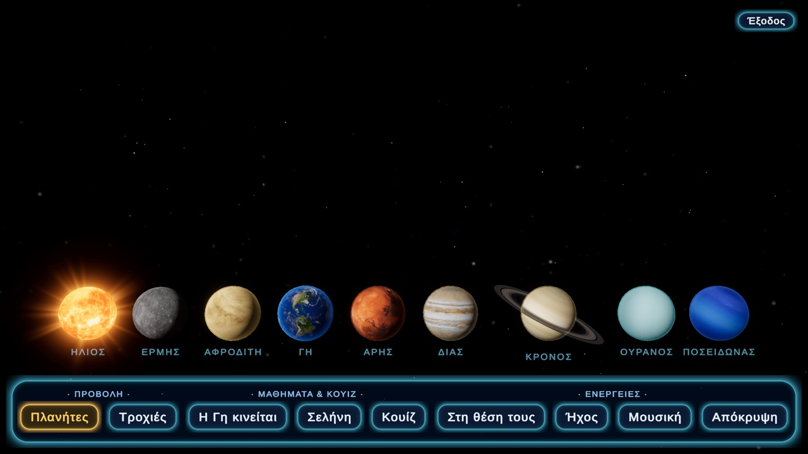
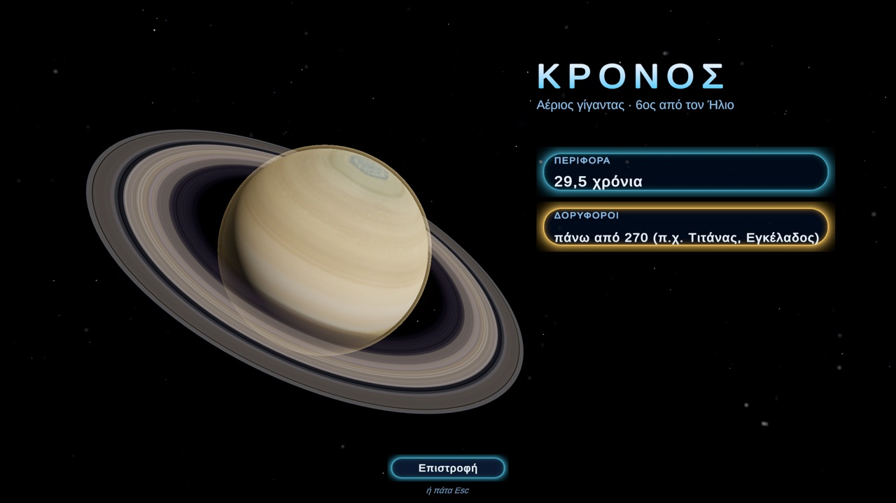
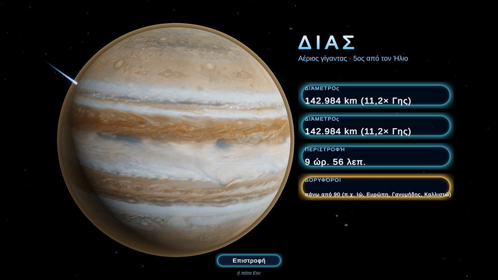
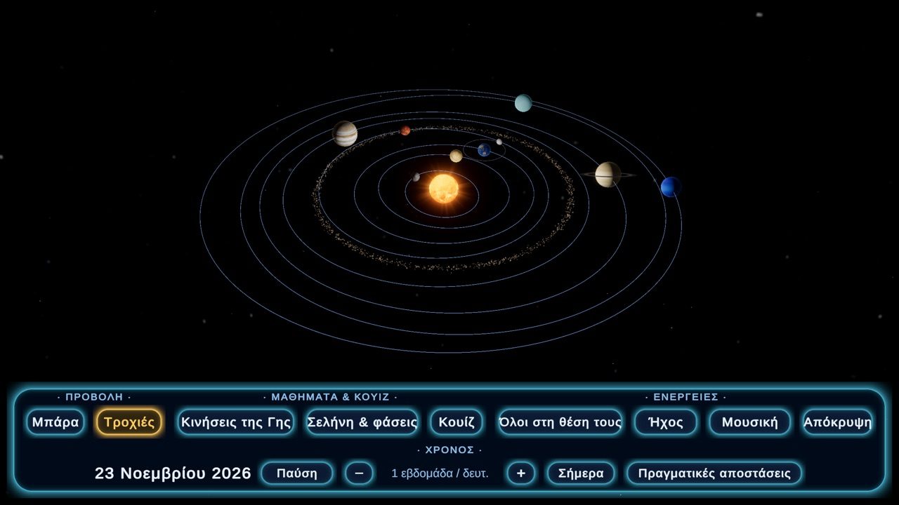
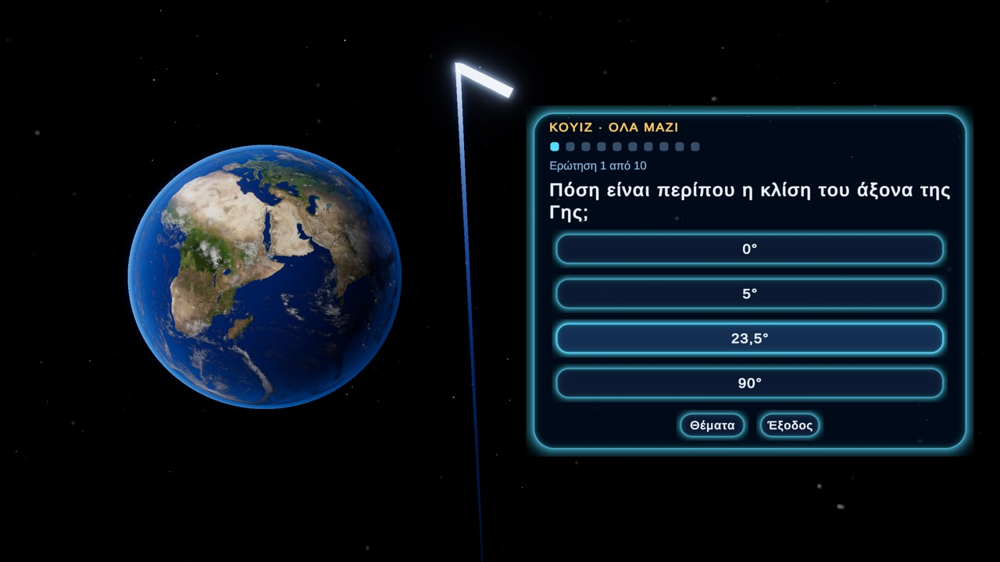
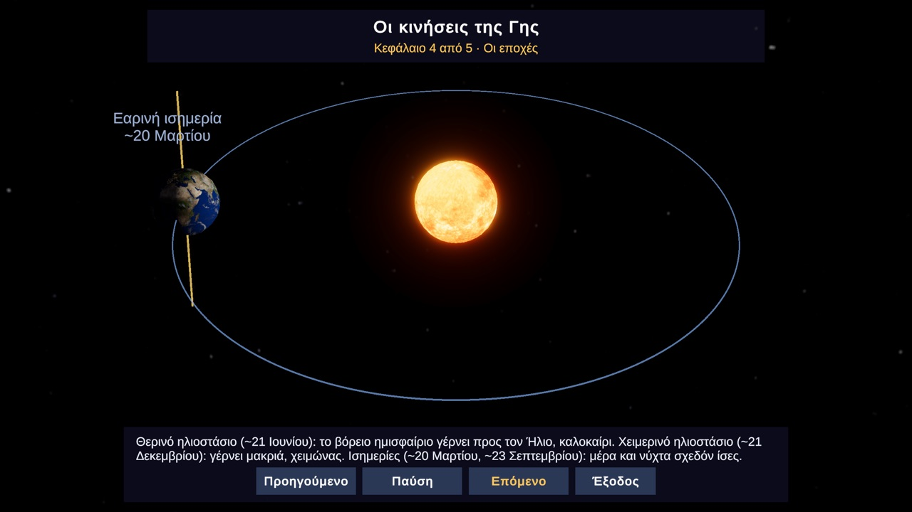

# Ηλιακό Σύστημα 🪐

Εκπαιδευτική εφαρμογή στα ελληνικά για το Ηλιακό Σύστημα, για μαθητές/τριες Δημοτικού και Γυμνασίου.
Πιάνεις τους πλανήτες, τους μεγαλώνεις και ταξιδεύεις κοντά τους με αφήγηση, βλέπεις τις πραγματικές τους τροχιές, κάνεις μαθήματα και παίζεις κουίζ.

## ▶️ (https://xristinaklime.github.io/hliako-systima/)

Δε χρειάζεται εγκατάσταση. Άνοιξέ τη σε **υπολογιστή** (Chrome, Edge, Firefox ή Safari) και περίμενε λίγα δευτερόλεπτα να φορτώσει. Ο ήχος ξεκινά με το πρώτο κλικ.

## Τι περιέχει

- **Εισαγωγή-ταξίδι**: ήρεμη «κρουαζιέρα» δίπλα από τον Κρόνο, τον Δία και τη Γη με τη Σελήνη
- **Οι πλανήτες σε σειρά**: ο Ήλιος και οι 8 πλανήτες με πραγματικές υφές, ατμόσφαιρες και ζωντανό Ήλιο
- **Καρτέλες πληροφοριών** με αφήγηση στα ελληνικά
- **Ταξίδι σε έναν πλανήτη** (διπλό κλικ): ο πλανήτης έρχεται κοντά, η κάμερα κάνει βόλτα γύρω του και τα στοιχεία του «ανάβουν» καθώς τα λέει ο αφηγητής
- **Τροχιές**: οι θέσεις των πλανητών για οποιαδήποτε ημερομηνία (στοιχεία NASA/JPL), η ζώνη των αστεροειδών και οι πραγματικές αποστάσεις
- **Μαθήματα**: «Η Γη κινείται» (περιστροφή, περιφορά, κλίση, εποχές) και «Σελήνη» (φάσεις, εκλείψεις)
- **Κουίζ** με 46 ερωτήσεις, κινούμενους πλανήτες και ερωτήσεις-«μυστήριο»
- **Ζωντανό διάστημα**: αστέρια που τρεμοπαίζουν, πεφταστέρια, κομήτες
- **Δική της μουσική**, που χαμηλώνει όταν μιλά ο αφηγητής

| | |
|---|---|
|  |  |
|  |  |

## Χειρισμός

| Κίνηση | Τι κάνει |
|---|---|
| Κλικ σε πλανήτη | Καρτέλα πληροφοριών και αφήγηση |
| Διπλό κλικ σε πλανήτη | Ταξίδι κοντά στον πλανήτη |
| Κλικ + σύρσιμο σε πλανήτη της σειράς | Τον βγάζεις από τη σειρά |
| Κλικ + σύρσιμο σε πλανήτη έξω από τη σειρά | Τον γυρίζεις «στο χέρι» |
| Shift + σύρσιμο | Μετακίνηση |
| Ροδέλα ή δύο δάχτυλα πάνω-κάτω | Μεγαλώνει / μικραίνει |
| Esc | Επιστροφή από το ταξίδι σε πλανήτη |

Τα κουμπιά στο κάτω μέρος αλλάζουν προβολή (**Πλανήτες** / **Τροχιές**), ξεκινούν τα μαθήματα και το κουίζ, βάζουν τους πλανήτες **Στη θέση τους** και ανοίγουν/κλείνουν ήχο και μουσική.

## Τεχνολογία

- **Unity 6** (Universal Render Pipeline), έκδοση για browser (WebGL)
- Σε εξέλιξη: έκδοση για **Meta Quest 3** (μικτή πραγματικότητα, με χέρια και χειριστήρια)

## Πηγές και ευχαριστίες

- **Υφές πλανητών και ουρανού**: [Solar System Scope](https://www.solarsystemscope.com/textures/), με άδεια [CC BY 4.0](https://creativecommons.org/licenses/by/4.0/). Βασίζονται σε δεδομένα της NASA.
- **Αστρονομικά στοιχεία**: [NASA Planetary Fact Sheets](https://nssdc.gsfc.nasa.gov/planetary/factsheet/)
- **Θέσεις πλανητών**: [NASA/JPL Solar System Dynamics](https://ssd.jpl.nasa.gov/planets/approx_pos.html), «Keplerian Elements for Approximate Positions of the Major Planets» (E. M. Standish)
- **Θέση της Σελήνης**: απλοποιημένοι τύποι από J. Meeus, «Astronomical Algorithms»
- **Φωνή αφήγησης**: Microsoft Neural TTS, φωνή «el-GR-NestorasNeural», μέσω του εργαλείου [edge-tts](https://github.com/rany2/edge-tts)
- **Γραμματοσειρά**: Liberation Sans (μέσω TextMesh Pro), με άδεια SIL Open Font License 1.1
- **Μουσική και ηχητικά εφέ**: πρωτότυπα, φτιαγμένα με κώδικα μέσα στην εφαρμογή

## Δημιουργία

Σχεδιασμός και ανάπτυξη: **ΧΡΙΣΤΙΝΑ ΚΛΗΜΕΝΤΙΩΤΗ** ([@xristinaklime](https://github.com/xristinaklime)).

Η εφαρμογή είναι εκπαιδευτική και μη εμπορική.
